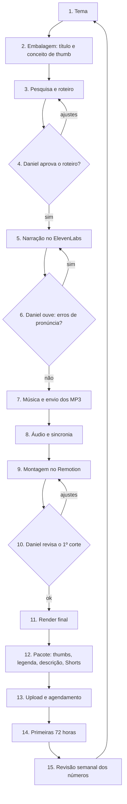

# Fluxo de produção — Billions & Bulls

Como um vídeo sai da ideia até o YouTube. Vale para os dois lados: o Daniel e o Claude.
Criado em 27/10/2026. Quando o processo mudar, este arquivo muda junto.

**Quem faz o quê**
- **Daniel:** decide, aprova, gera a narração, escolhe a música e publica.
- **Claude Code:** pesquisa, escreve, checa fatos, monta o vídeo, faz as thumbs e prepara o pacote de upload. Trabalha neste repositório, numa sessão por episódio.
- **Claude (Project "Yt Dark"):** conversa livre, brainstorming e ideias. Decisões tomadas lá precisam ser trazidas para este repositório, que é a fonte da verdade.

---

## Bloco 1 — Ferramentas

### Ferramentas de produção (todo vídeo)

| Ferramenta | Para quê | Quem usa | Custo |
| --- | --- | --- | --- |
| **Claude Code** (este repositório) | Pesquisa, roteiro, checagem, montagem no Remotion, thumbs, legenda, Shorts, pacote de upload | Claude | Assinatura do Claude que o Daniel já tem |
| **GitHub** (repositório Billions-n-Bulls) | Guarda roteiros, docs, código do Remotion e decisões | Claude | Grátis |
| **Dark Planner** (usa a base do ElevenLabs) | Narração. Voz Lucan Rook, modelo Multilingual v2, velocidade 1,06, estilo 40%. O Daniel confirmou em 27/10/2026 que o plano dele permite uso comercial; guardar um print dos termos e do plano para o caso de uma revisão do YouTube | Daniel | Pago |
| **Remotion 4.0.539** | Animação e montagem do vídeo e das thumbs (código React) | Claude | Grátis para uso individual |
| **sherpa-onnx** (Whisper small + Parakeet) | Mede o tempo de cada palavra da narração para sincronizar o texto na tela | Claude | Grátis |
| **ffmpeg** | Junta e normaliza o áudio (-14 LUFS), mixa trilha e efeitos | Claude | Grátis |
| **Trilha original** (`scripts/audio/trilha_show.py`, preset **Spark**, escolhido pelo Daniel em 28/10/2026; alternativas calmas em `trilha.py`) | Trilha de fundo sintetizada pelo Claude: sem direitos de terceiros e sem risco de reivindicação do Content ID. A Biblioteca de áudio do YouTube continua como alternativa, escolhida pelo Daniel (o Claude não acessa o Studio) | Claude | Grátis |
| **Bancos de imagem** | Wikimedia Commons, Library of Congress, Pexels, Unsplash, SEC EDGAR, sites de RI das empresas | Claude | Grátis (licença conferida item a item) |
| **YouTube Studio** | Upload, Test & Compare de thumbs, legenda, tela final, cards, Analytics | Daniel | Grátis |

### Ferramentas de apoio (quando precisar)

| Ferramenta | Para quê | Quem usa |
| --- | --- | --- |
| **Google Trends / barra de busca do YouTube** | Conferir se um tema tem demanda antes de escrever | Daniel (o Claude não acessa o Trends) |
| **vidIQ ou TubeBuddy (plano grátis)** | Volume de busca e concorrência de um título | Daniel, opcional |
| **Google Drive** | Plano B para transferir o vídeo final se o arquivo for grande demais para o app | Os dois |
| **Instagram / TikTok** | Repostar os Shorts, mais adiante | Daniel, opcional |

**Custo fixo hoje:** só o Dark Planner (narração). Todo o resto é grátis.

---

## Bloco 2 — Passo a passo de um vídeo

### Pré-produção

**1. Tema** — Daniel + Claude
- O Claude propõe 2 ou 3 temas da `ideias/fila.md`, com o dado que sustenta cada um.
- Critérios do blueprint (`CLAUDE.md`): fato concreto com alguém responsável, ligado ao bolso de quem assiste ou à Europa. Nada de panorama, série trocando só o país, remake ou notícia do momento.
- Daniel confere a demanda (barra de busca do YouTube ou Google Trends) e escolhe.

**2. Embalagem primeiro** — Claude propõe, Daniel aprova
- Título principal (até ~45 caracteres, uma tensão só) + 2 títulos reserva.
- Conceito das 3 thumbs: frase de 2 ou 3 palavras + gráfico com dado real + ponto dourado.
- Regra: o roteiro é escrito para cumprir a promessa do título e da thumb, não o contrário.

**3. Pesquisa e roteiro** — Claude
- Pesquisa em fontes primárias (balanços, 10-K, relatórios da SEC e da FINRA).
- Roteiro em inglês no formato do ElevenLabs: abertura de ~35 s, 6 partes, fechamento padrão, pausas `<break>`.
- Tabela de checagem com fonte de cada número.
- Mapa de retenção (perguntas que abrem e fecham) e plano visual cena a cena.
- Entrega: `roteiros/rascunhos/epNN-slug.md`.

**4. Aprovação do roteiro** — Daniel
- Ler o roteiro inteiro antes de gastar créditos no ElevenLabs.
- Pedir ajustes aqui na conversa. Aprovado, o arquivo vai para `roteiros/prontos/`.

### Áudio

**5. Narração** — Daniel, no ElevenLabs
- Colar os blocos do roteiro (até ~3.500 caracteres cada, cortados nos títulos de parte).
- Configuração fixa: Lucan Rook, Multilingual v2, velocidade 1,06, estilo 40%.
- Nome dos arquivos: `epNN-A.mp3`, `epNN-B.mp3`, `epNN-C.mp3`…

**6. Escuta** — Daniel
- Ouvir tudo uma vez. Números, siglas e nomes são onde a voz mais erra.
- Se errar: regerar só o trecho. Se o erro se repetir, avisar o Claude, que reescreve a frase (por exemplo, "3.4 billion" por extenso).

**7. Música e envio** — Daniel
- Escolher 2 ou 3 faixas calmas, sem batida marcada, na Biblioteca de áudio do YouTube.
- Anotar se a faixa pede crédito na descrição.
- Mandar MP3 da narração e da música aqui na conversa.

### Montagem

**8. Áudio e sincronia** — Claude
- Junta os blocos, normaliza em -14 LUFS (pico -1 dB).
- Mede o tempo de cada palavra e acerta a minutagem real dos capítulos.

**9. Montagem** — Claude, no Remotion
- Constrói as telas novas que o plano visual pedir (print de cada uma para o Daniel aprovar).
- Monta as cenas sobre a narração: tela muda a cada 4 a 8 s, efeitos (tick, whoosh, boom), trilha 18 a 24 dB abaixo da voz.

**10. Revisão do 1º corte** — Daniel
- O Claude manda uma versão em 720p.
- Daniel assiste inteiro e manda ajustes com a minutagem ("3:12 – número entra cedo").
- Uma ou duas rodadas.

**11. Render final** — Claude
- 1080p, 30 fps, H.264 CRF 18. O arquivo fica fora do git e é enviado aqui pelo app (ou pelo Google Drive, se for grande demais).

### Pacote de publicação

**12. Pacote** — Claude
- 3 thumbnails 1280×720, conferidas num feed simulado (modo claro e escuro, tamanhos pequenos).
- Legenda `.srt` em inglês, gerada do texto final.
- Descrição: número-tese, lista "In this video", capítulos, fontes, frase de originalidade, aviso de que não é recomendação financeira.
- Tags, comentário fixado, sugestão de tela final e card.
- 3 Shorts verticais (9:16, 20 a 45 s), cada um com uma afirmação e um número no título.

### Publicação

**13. Upload e agendamento** — Daniel, no YouTube Studio
- Subir o vídeo, colar título e descrição, enviar a legenda.
- Categoria Education · idioma English · não é para crianças · conteúdo alterado ou sintético: Não · sem promoção paga.
- Test & Compare com as 3 thumbs.
- Tela final (últimos 20 s) e card do Cargo & Capital.
- **Agendar** para o horário fixo: meio-dia de Nova York (14h de Brasília a partir de 01/11), sempre no mesmo dia da semana.
- Shorts agendados para os dias seguintes, às 18h de Nova York.

**14. Primeiras 72 horas** — Daniel
- Responder todos os comentários da primeira hora e fixar o comentário.
- Com 1.000 impressões ou mais e CTR abaixo de 4%: trocar para o título reserva.
- Mandar ao Claude um print da retenção (principalmente aos 30 s) e do CTR.

**15. Revisão semanal** — Daniel manda, Claude analisa
- Print do Analytics: views, CTR, retenção, de onde veio o tráfego.
- O Claude atualiza a fila de temas e ajusta o próximo roteiro (abertura, ritmo, embalagem).

---

## Calendário de uma semana (1 vídeo por semana, publicação na terça)

| Dia | O quê | Quem |
| --- | --- | --- |
| Quarta | Tema e embalagem do próximo vídeo | Daniel + Claude |
| Quinta e sexta | Pesquisa, roteiro e checagem | Claude |
| Sábado | Aprovação do roteiro, narração e música | Daniel |
| Domingo e segunda | Sincronia, montagem e 1º corte | Claude |
| Segunda à noite | Revisão do 1º corte | Daniel |
| Terça de manhã | Render final e pacote | Claude |
| Terça, 14h de Brasília | Publicação | Daniel |
| Quarta a sexta | Shorts, 18h de NY | Daniel |

No começo, com as telas ainda sendo construídas, a montagem vai levar mais tempo. O ritmo de uma semana vale a partir do 2º ou 3º vídeo.

---

## Configuração única do canal (fazer uma vez)

- [ ] **Verificar o canal por telefone** no YouTube Studio. Sem isso, o YouTube não aceita vídeo com mais de 15 minutos nem thumbnail personalizada.
- [ ] Banner, foto e descrição do canal, com o link do Cargo & Capital.
- [ ] Padrões de upload no Studio (categoria Education, idioma English, descrição com o aviso padrão).
- [ ] Playlist por pilar (Who Pays · Scams & Disasters · Strange Money · Hidden Businesses).
- [ ] Marca d'água de inscrição (a moeda B&B).
- [ ] Dark Planner (base ElevenLabs) com licença comercial; print dos termos e do plano guardado.
- [ ] Conferir a política de atividades externas da Ford antes de monetizar.

## Aquecimento do canal (3 a 7 dias antes da estreia)

O que ajuda de verdade é o canal completo, verificado e com cara de real. A ideia de "treinar o algoritmo" com o histórico do dono não tem comprovação: o YouTube recomenda cada vídeo pelo comportamento de quem assiste (clique, retenção, satisfação).

- [ ] Verificação por telefone feita (item acima). É o mais importante.
- [ ] Foto, banner e descrição no ar antes do primeiro vídeo.
- [ ] Padrões de upload configurados no Studio.
- [ ] Todo dia: assistir até o fim e comentar de verdade em vídeos dos canais de referência (Casual Finance e `docs/canais-referencia.md`), sem divulgar o próprio canal. Anotar temas e dúvidas que aparecem nos comentários: viram ideias para a fila.
- [ ] Usar sempre o mesmo aparelho e a mesma rede, sem VPN.
- [ ] Não publicar no mesmo dia em que o canal ficar pronto, nem subir vários vídeos de uma vez.
- [ ] Nunca comprar inscritos ou views, nem trocar inscrição com outros canais.
- [ ] Estreia: ep. 1 numa terça, ao meio-dia de Nova York (14h de Brasília); Shorts nos dias seguintes, às 18h de Nova York.

## Quando o canal for monetizar

- [ ] Conta do AdSense ligada ao canal.
- [ ] Cadastro fiscal americano no AdSense (formulário W-8BEN). O YouTube retém imposto sobre as views vindas dos EUA, e o Brasil não tem tratado com os EUA: **conferir com um contador** como isso entra no seu imposto de renda aqui.
- [ ] Anúncios no meio do vídeo só nas viradas de parte.

## Como as coisas chegam de um lado para o outro

| Do Daniel para o Claude | Do Claude para o Daniel |
| --- | --- |
| Aprovação do tema, do título e do roteiro (aqui na conversa) | Roteiro (no repositório e resumido aqui) |
| MP3 da narração: `epNN-A.mp3`, `epNN-B.mp3`… | Prints das telas novas para aprovar |
| MP3 das músicas escolhidas | 1º corte em 720p |
| Ajustes do 1º corte, com minutagem | Vídeo final em 1080p |
| Prints do Analytics | 3 thumbs, `.srt`, Shorts e o texto da descrição, tags e comentário fixado |

## B-roll: fotos e vídeos de arquivo (desde o ep. 2)

Pedido do Daniel e do sócio: mais imagens reais entre as telas animadas. Regra: cada foto passa pelo tratamento da marca (duotone tinta/papel ou azul-marinho, zoom lento, grão, destaque dourado) para o vídeo não virar colagem de banco de imagens.

| Fonte | Para quê | Chave |
| --- | --- | --- |
| Openverse (indexa Wikimedia Commons, Flickr…) | Lugares, prédios, objetos | Não (200 buscas/dia) |
| Library of Congress | Fotos históricas dos EUA | Não |
| Pixabay | Cenas genéricas (pagar com cartão, loja, celular) e **vídeos** | Sim, grátis (`~/.config/bnb/pixabay_key`, nunca no repositório) |

Observação: pela API grátis, as **fotos** do Pixabay vêm com no máximo 1280 px (viram "foto impressa"); os **vídeos** vêm em 1080p e entram em tela cheia. Para cena genérica, preferir vídeo (`--fonte pixabay-video`).

Passo a passo:
1. `python3 scripts/imagens/buscar.py ep02 p1-store "small shop owner counter" --fonte pixabay` → folha de contato em `media/imagens/ep02/candidatos/`.
2. Revisar a folha: sem logo de empresa, sem pessoa identificável em destaque, combina com a frase.
3. `python3 scripts/imagens/escolher.py ep02 p1-store 3` → baixa em alta para `scripts/remotion/public/img/ep02/` e registra autor e licença em `src/ep02/creditos.json`.
4. Na cena: `photo('p1-store', {...})`. Foto com menos de 1.500 px vira "foto impressa" automaticamente; cena sem foto escolhida aparece como "B-ROLL PENDENTE".
5. Na publicação: `escolher.py ep02 --creditos` gera o bloco de créditos da descrição.

As cenas apontam para frases do roteiro (`src/epkit/cues.ts`), não para segundos. Antes da narração, `scripts/sync/timeline_provisoria.py` estima os tempos; quando o MP3 chega, a transcrição substitui o `timeline.json` e tudo se realinha.
